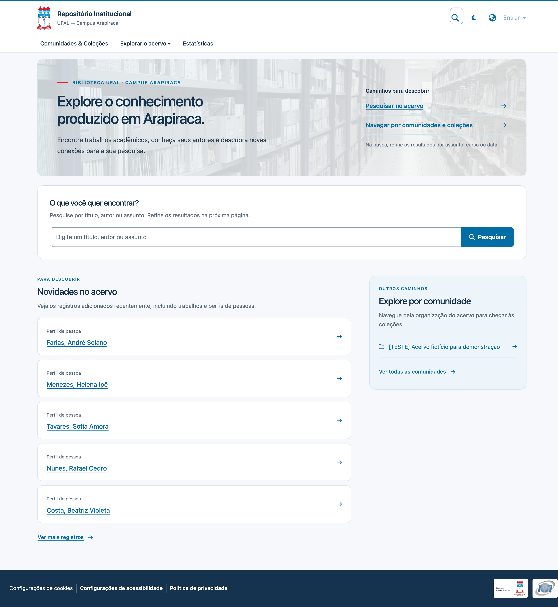
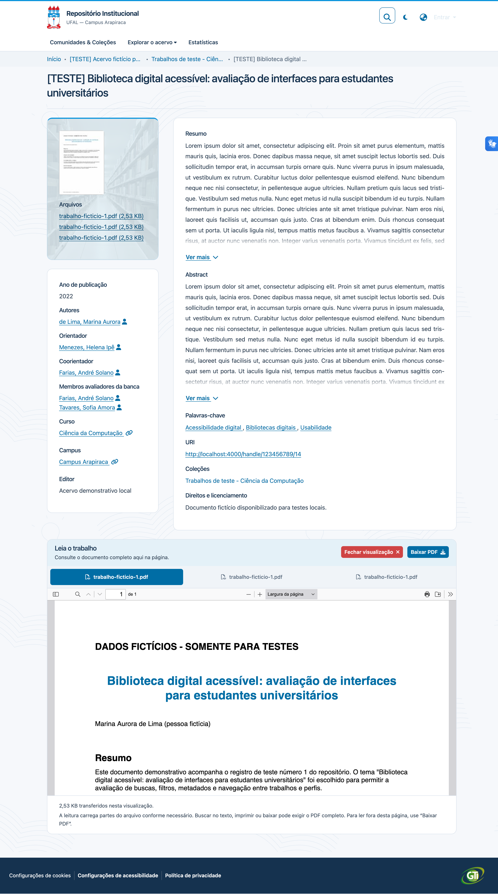

# Repositório Institucional UFAL — Campus Arapiraca

Este repositório reúne a implantação Docker e as personalizações do **DSpace 10.1** usado pela Biblioteca da UFAL — Campus Arapiraca. Mantém o backend, a interface Angular, o proxy e a documentação operacional.

A migração do acervo legado é feita no projeto irmão [`dspace-migration`](https://github.com/NTI-UFAL-Arapiraca/dspace-migration). Este projeto prepara configurações e metadados acadêmicos, mas não extrai nem importa trabalhos.

## Interface

As capturas mostram a página inicial e a página de um trabalho. Os registros exibidos são fictícios e servem apenas para demonstração e testes locais.



*Página inicial.*



*Página de informações do trabalho, com metadados acadêmicos e leitura integrada do PDF.*

## O repositório

O DSpace organiza os trabalhos como itens, agrupados em comunidades e coleções. Neste projeto, os registros também incluem curso, campus e vínculos com pessoas. `Person` é o cadastro bibliográfico usado em autoria, orientação, coorientação e banca; `EPerson` é uma conta de acesso. Os cadastros de autores e professores não criam contas de login.

A interface apresenta os trabalhos, seus resumos e arquivos, permite a leitura de PDFs na página e relaciona os registros aos perfis bibliográficos das pessoas. A home reúne busca, comunidades e registros recentes. As páginas e os dados são servidos pela interface Angular e pela API REST do DSpace.

## Executar localmente

Na raiz do projeto, prepare o arquivo de ambiente e preencha a senha do banco, o caminho da base GeoLite2 e a pasta SAF:

```bash
cp .env.development.example .env.development
```

Inicie os serviços:

```bash
docker compose --env-file .env.development -p d10dev \
  -f docker-compose-rest.yml -f docker-compose-dev.yml up -d --build
```

Abra `http://localhost:4000/`. A interface e a API usam portas locais em loopback; o ambiente `d10dev` tem banco, Solr e assetstore próprios. Para criar o administrador, registrar os metadados e encerrar os serviços, consulte o [guia de inicialização local](docs/guias/inicializacao-local.md).

## Implantação

Em produção, a implantação combina `docker-compose-dist.yml`, `docker-compose-rest.yml` e `docker-compose-prod.yml`. Apenas o proxy interno publica a porta 80; o proxy institucional termina TLS e encaminha a interface em `/dspace/` e a API em `/dspace-server/`.

O workflow do GitHub Actions compila o tema e publica a imagem Angular no GHCR em pushes para `main`; também pode ser iniciado manualmente. Configurações de runtime e de backend são montadas separadamente. Consulte o [guia de produção](docs/guias/inicializacao-producao.md) e a [referência de implantação](docs/referencia/implantacao.md) antes de alterar URLs, rede, imagens ou proxy.

## Estrutura do projeto

| Caminho | Responsabilidade |
| --- | --- |
| `docker-compose-*.yml` | Serviços e overlays de produção, desenvolvimento, acesso local e migração. |
| `proxy/nginx.conf` | Rotas HTTP para Angular e REST, com cabeçalhos de proxy. |
| `backend/config/` | Metadados, formulários, autoridades, Discovery e propriedades REST. |
| `frontend/config/` | Configuração Angular carregada em runtime. |
| `frontend/themes/custom/` | Componentes, estilos, assets e traduções institucionais. |
| `frontend/overrides/` e `frontend/patches/` | Extensões aplicadas ao Angular oficial durante o build. |
| `Dockerfile.angular` e `.github/workflows/deploy.yml` | Build e publicação da imagem Angular. |
| `scripts/` | Preparação idempotente dos metadados acadêmicos e da coleção Pessoas. |
| `tests/` | Verificações da configuração acadêmica e dos scripts de preparação. |
| `docs/` e `rfc/` | Guias, referências e decisões de arquitetura. |

## Documentação

- [Índice dos guias e referências](docs/README.md)
- [Inicialização local](docs/guias/inicializacao-local.md)
- [Inicialização e atualização em produção](docs/guias/inicializacao-producao.md)
- [Operação e verificação](docs/guias/operacao.md)
- [Preparação de metadados acadêmicos e da coleção Pessoas](docs/guias/preparacao-academica.md)
- [Modelo acadêmico e autoridades de pessoas](docs/referencia/modelo-academico.md)
- [Configuração do backend](backend/README.md)
- [Personalização do tema Angular](frontend/themes/custom/README.md)
- [Decisões registradas nas RFCs](rfc/README.md)
- [Migração do acervo legado](../dspace-migration/docs/README.md)
