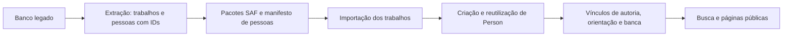

# Modelo acadêmico e pessoas

Configuração do DSpace **10.1**, baseada no **Authority Framework**.
Para executar a preparação, use o [roteiro próprio](../guias/preparacao-academica.md).

No DSpace, um trabalho é um **item**: seus arquivos, título, resumo e outros
metadados ficam juntos. Uma coleção agrupa itens; uma comunidade agrupa
coleções e outras comunidades. Nossa organização por campus e curso continua
existindo. Adicionamos uma coleção de pessoas à organização do repositório.

| Termo | O que significa neste projeto |
| --- | --- |
| Item | Um trabalho ou outro registro descrito no repositório. |
| Metadado | Um campo de descrição: título, curso, resumo, orientador etc. |
| `Person` | Cadastro bibliográfico de uma pessoa, com página própria. |
| `EPerson` | Conta usada para fazer login. É independente do cadastro bibliográfico. |
| Autoridade | Referência estável ao UUID de uma pessoa cadastrada. |
| UUID | Identificador interno atribuído pelo DSpace. |
| Handle | Identificador persistente do trabalho, preservado nos lotes já importados. |
| SAF | Pasta de importação com os arquivos e metadados de cada trabalho. |
| Discovery/Solr | Índice usado pelas buscas, seletores e listas de trabalhos relacionados. |

Uma pessoa pode ser autora de um trabalho e orientadora de outro. Guardamos
o cadastro uma vez e registramos seu papel em cada trabalho. Os autores e
professores migrados não recebem contas de acesso: a biblioteca administra
os cadastros. O administrador usa sua própria conta para preparar e revisar
a migração.

Os seguintes arquivos já estão integrados à implantação. Não é necessário
copiar o exemplo `people-authority.cfg.example` manualmente para o container.

| Arquivo | Função |
| --- | --- |
| `backend/config/config-definition.xml` | Carrega os overrides acadêmicos e preserva o mecanismo de `local.cfg` e variáveis de ambiente. |
| `backend/config/people-authority.cfg` | Registra a pesquisa de pessoas locais e associa os quatro papéis à mesma autoridade. Mantém `EPersonAuthority`, fornecida pela imagem. |
| `backend/config/modules/rest.cfg` | Preserva as propriedades REST oficiais e expõe o modelo de relações para a verificação da migração. |
| `backend/config/item-submission.xml` | Acrescenta a seção acadêmica à submissão e à edição de trabalhos. |
| `backend/config/submission-forms.xml` | Define os controles de edição e os seletores fechados de pessoas. |
| `backend/config/registries/academic-metadata.xml` | Cadastra os campos adicionais. |
| `backend/config/spring/api/academic-discovery.xml` | Acrescenta buscas por autoria, orientação, coorientação e banca, sem substituir as buscas oficiais. |
| `frontend/themes/custom/` | Mostra nomes com links, curso e campus nos trabalhos e quatro abas no perfil de uma pessoa. |

Os arquivos do backend são montados como somente leitura nos serviços
`dspace` e `dspace-cli`. As classes dos plugins já pertencem ao DSpace;
`MigrationPersonAuthority` é o nome que usamos para pesquisar registros
`Person`. Não há um JAR adicional para instalar.

Os campos do acervo ficam assim:

| Informação | Campo |
| --- | --- |
| Curso | `local.course.name` |
| Campus | `local.campus.name` |
| Autor | `dc.contributor.author` |
| Orientador | `dc.contributor.advisor` |
| Coorientador | `dc.contributor.coadvisor` |
| Avaliador da banca | `dc.contributor.referee` |

Curso e campus são campos de texto editáveis nesta entrega. Os quatro
campos de pessoas usam seleção de cadastro existente. Se a pessoa ainda não
existir, a biblioteca a cadastra na coleção Pessoas e depois a seleciona no
trabalho. Programa de pós-graduação e grau acadêmico não são deduzidos do
nome do curso.

## Relações e acervo existente

`relationship.enable-virtual-metadata=false` seleciona o modelo por
autoridade. Alterar a propriedade não converte relacionamentos virtuais
existentes. O enriquecimento da migração associa UUIDs aos nomes persistidos
e preserva handles, arquivos e políticas dos trabalhos.

Os processos tradicional e Publication, inclusive os de edição, contêm a
seção Dados acadêmicos. A coleção Pessoas contém entidades Person; os
seletores usam esses cadastros e os perfis consultam Discovery por papel.
Uma aba vazia significa ausência de trabalhos naquele papel.

O legado possui tabelas separadas para autores e orientadores. A identidade
é `odoo:TABELA:ID`; nomes iguais não provocam fusão automática. O modelo de
conciliação está descrito na [referência de pessoas da migração](../../../dspace-migration/docs/referencia/pessoas-e-vinculos.md).

## Referências oficiais

- [Authority Framework](https://wiki.lyrasis.org/spaces/DSDOC10x/pages/425331229/Authority%2Bframework%2Bfunctionalities).
- [Formulários 10.1](https://github.com/DSpace/DSpace/blob/dspace-10.1/dspace/config/item-submission.xml).
- [Entidades configuráveis](https://wiki.lyrasis.org/spaces/DSDOC10x/pages/408944761/Configurable%2BEntities).
