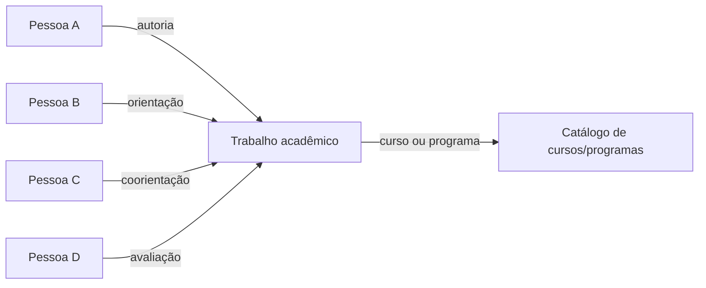

Relatório técnico — metadados acadêmicos, edição e pessoas no DSpace 10.1

Pesquisa realizada em 13/10/2026, considerando a versão configurada neste
projeto, a documentação oficial 10.x e os arquivos oficiais disponíveis na
tag `dspace-10.1`. As recomendações abaixo são propostas para implementação.

Atualização de contexto: a migração está em andamento e o legado mantém
cadastros de pessoas sem contas de acesso. A proposta passa a ser importar
essas pessoas como entidades `Person` desde a migração e revisar agora os
nomes locais inadequados. A criação de contas `EPerson` fica condicionada à
necessidade de acesso dos titulares.

Implementação preparada no projeto de migração: a extração agora gera
`local.course.name`, `local.campus.name`, `metadata_local.xml` e um manifesto
de pessoas por tabela, ID e papel. O novo comando `apply-people` cria/reutiliza
entidades `Person`, aplica autoridades e converte os campos acadêmicos dos
lotes anteriores. Inclui simulação e retomada; 85 testes automatizados
passaram. Em 14/10/2026, os overrides do backend, os formulários e os perfis
também foram integrados à implantação. O build Angular e a validação dos
arquivos na imagem oficial da CLI passaram. A execução contra a instalação
e a revisão do lote continuam sendo etapas operacionais. Siga o
[guia atual de preparação e execução](../README.md) e o
[guia de pessoas e vínculos](../../../dspace-migration/docs/referencia/pessoas-e-vinculos.md).

Os achados abaixo registram o estado anterior à implementação; o guia atual
é a referência para os arquivos e os comandos já integrados.

**O DSpace já oferece a base para cadastrar pessoas e relacioná-las aos
trabalhos.** A adaptação necessária envolve formulários, identidade das
pessoas, apresentação e migração. O problema dos campos ausentes e a criação
dos perfis devem ser tratados como entregas relacionadas, com validações
próprias.

**O que está confirmado no projeto.** O arquivo
[`backend/config/submission-forms.xml`](../../backend/config/submission-forms.xml)
é montado nos serviços REST e CLI. Seus formulários `traditionalpageone`,
`traditionalpagetwo` e `publicationStep` não incluem orientador,
coorientador, banca, curso nem campus. Também faltam controles específicos
para `dc.description.note` e `dc.format.extent`.

Já a página pública customizada
[`untyped-item.component.html`](../../frontend/themes/custom/app/item-page/simple/item-types/untyped-item/untyped-item.component.html)
exibe `dc.contributor.advisor` e `dc.contributor.referee`. Isso explica por que
um valor importado pode aparecer na página do trabalho e não ter um controle
no formulário de edição. A
[`RFC 0004`](../../rfc/0004-metadados-academicos-na-pagina-do-item.md)
registra essa alteração de exibição.

Também consultei o projeto irmão de migração, especialmente
[`metadados_customizados.md`](../../../dspace-migration/docs/referencia/metadados-customizados.md),
[`migration-metadata.xml`](../../../dspace-migration/config/registries/migration-metadata.xml)
e [`extract_metadata.sql`](../../../dspace-migration/sql/extract_metadata.sql).
Na investigação inicial, eles estabeleciam os seguintes significados. Os
aliases de curso e campus foram posteriormente substituídos no pipeline,
conforme a atualização acima:

| Informação | Campo atual | Sugestão para a edição |
| --- | --- | --- |
| Curso ou programa | `dc.description.degree` | Seleção de catálogo controlado, com rótulo “Curso/programa”. |
| Campus | `dc.publisher.department` | Seleção controlada, com rótulo “Campus”. |
| Orientador | `dc.contributor.advisor` | Seleção de pessoa cadastrada. |
| Coorientador | `dc.contributor.coadvisor` | Seleção de pessoa cadastrada; múltiplos valores quando aplicável. |
| Avaliador da banca | `dc.contributor.referee` | Seleção de pessoas cadastradas, preservando a ordem. |
| Observação de acervo | `dc.description.note` | Texto, com ajuda que explique seu uso público. |
| Número de páginas | `dc.format.extent` | Controle próprio, com regra acordada pela catalogação. |

`degree` significa **curso/programa nesta migração**, e não grau acadêmico.
`department` significa **campus**, e não necessariamente departamento.
Como a migração ainda está em andamento, recomendo corrigir agora esses
nomes, alinhando a extração e a instalação de destino antes da importação
definitiva. A recomendação inicial de preservá-los pressupunha maior custo
de compatibilidade com um acervo já consolidado.

Uma proposta de nomenclatura para discussão com a catalogação é:

| Conceito | Campo proposto |
| --- | --- |
| Nome do curso | `local.course.name` |
| Nome do programa de pós-graduação, quando distinto do curso | `local.program.name` |
| Nome do campus | `local.campus.name` |
| Nível do grau: graduação, mestrado, doutorado | `local.degree.level` |

Esses nomes são uma proposta de esquema local, não campos padrão do DSpace
nem uma afirmação de conformidade com um padrão bibliográfico. Antes de
adotá-los, verificar o perfil de metadados exigido pelos serviços de coleta
utilizados pela instituição. O dado legado de curso não permite preencher
automaticamente programa e nível do grau sem uma regra validada.

A alteração deve abranger registro, extração SQL, gerador SAF, formulários,
exibição, buscas, exportação e testes. Para itens já importados, planejar a
conversão dos valores, mantendo UUIDs e handles e conferindo os novos campos
antes de retirar os antigos.

**Como a edição funciona.** Há duas experiências distintas: o editor
administrativo genérico de metadados e a edição por formulário na rota
`edit-items/`. No DSpace 10, os modos desta última são configurados em
`config/spring/api/edititem-service.xml`; cada modo aponta para uma definição
de processo em `item-submission.xml`. Seus campos vêm de
`submission-forms.xml`. Cadastrar um metadado no registro não o acrescenta
automaticamente ao formulário. A configuração de permissões também participa
da escolha dos modos disponíveis.
[Documentação oficial de edição por formulário](https://wiki.lyrasis.org/spaces/DSDOC10x/pages/425331237/Edit%2BItem%2Bin%2BSubmission%2Bmode).

Na configuração oficial 10.1, `traditional-edit` usa `traditionalpageone` e
`traditionalpagetwo`; `publication-edit` usa `publicationStep` e
`traditionalpagetwo`. Portanto, a ausência dos campos no XML local é uma
explicação concreta e compatível com o sintoma relatado. O processo efetivo
de cada coleção e o modo retornado ao administrador ainda precisam ser
conferidos na instalação.
[Processos oficiais da versão 10.1](https://raw.githubusercontent.com/DSpace/DSpace/dspace-10.1/dspace/config/item-submission.xml).

Para confirmar o encadeamento, uma inspeção autenticada pode consultar
`/api/core/edititems/search/findModesById?uuid=UUID_DO_ITEM`, verificar o
`submissionDefinition` retornado e conferir o formulário correspondente.
O contrato REST condiciona a edição de um campo à sua presença na definição
do modo escolhido.
[Contrato oficial de EditItem](https://github.com/DSpace/RestContract/blob/main/edititems.md).

**Onde fazer as adaptações.** O diretório `frontend/overrides/` é uma
convenção deste projeto: os arquivos são aplicados explicitamente pelo
Dockerfile ou pelos patches. Ele não é um catálogo automático de campos.
O [`Dockerfile.angular`](../../Dockerfile.angular) mostra esse mecanismo.

| Responsabilidade | Local adequado |
| --- | --- |
| Registrar o campo e seu significado | Registro de metadados, com XML versionado e importação pelo CLI. |
| Definir controles, ordem, repetição e ajuda | `backend/config/submission-forms.xml`. |
| Definir seções e processos por coleção/tipo | Override de `backend/config/item-submission.xml`, a acrescentar se necessário. |
| Definir modos e permissões de edição | Override de `backend/config/spring/api/edititem-service.xml`, se necessário. |
| Configurar autoridades de pessoas | Configuração do backend em `authority.cfg` ou propriedades locais equivalentes. |
| Mostrar nomes clicáveis e trabalhos relacionados | Componentes e traduções em `frontend/themes/custom/`. |
| Configurar filtros e consultas de perfis | Configuração de Discovery e, conforme o modelo, de relações por autoridade. |

Recomendo começar acrescentando os campos aos formulários efetivamente
utilizados. Um processo específico para trabalhos acadêmicos permite manter
essas regras separadas de outros acervos. Os novos overrides do backend
precisarão ser montados nos containers correspondentes e carregados após
reinício. Alterações apenas em XML de configuração normalmente dispensam
mudanças no código Java.

**Como representar professores, estudantes e orientadores.** O DSpace
possui entidades configuráveis, incluindo `Person`, `Publication` e
`OrgUnit`. Uma entidade é um item tipado, pertence a uma coleção e pode ter
relações com outras entidades. Isso permite manter uma coleção de pessoas
e reutilizar seus registros em vários trabalhos.
[Entidades configuráveis no DSpace 10](https://wiki.lyrasis.org/spaces/DSDOC10x/pages/408944761/Configurable%2BEntities).

O modelo precisa ser inicializado no banco com
`dspace initialize-entities -f /caminho/absoluto/relationship-types.xml`.
Depois, configuram-se coleções para os tipos necessários e seus processos de
submissão. Apenas montar o XML não ativa o modelo; tipar uma coleção também
não substitui o planejamento da conversão dos trabalhos já importados.
[Inicialização documentada das entidades](https://wiki.lyrasis.org/spaces/DSDOC10x/pages/408944761/Configurable%2BEntities).

Minha proposta é manter **um registro por pessoa**. “Autor”, “orientador”,
“coorientador” e “avaliador” descrevem sua participação em cada trabalho.
“Professor” e “estudante” podem representar vínculos institucionais, inclusive
com período de validade; não precisam produzir cadastros pessoais separados.
Uma pessoa pode orientar um trabalho e ser autora de outro.

Para os trabalhos, recomendo avaliar `Publication` como tipo de entidade,
mantendo tese, dissertação e outros tipos documentais em `dc.type`.
Para cada pessoa: nome preferido, variantes de nome, identificador de origem
e ORCID quando disponível. A criação do cadastro deve ficar inicialmente
sob curadoria da biblioteca, com um procedimento para solicitar pessoas
ausentes.

`EPerson` representa uma conta de acesso. Uma entidade `Person` representa
a pessoa descrita no acervo e pode existir sem essa conta, como os cadastros
do legado. A biblioteca pode criar e administrar essas pessoas e seus
vínculos sem lhes conceder login. Uma página pública com trabalhos orientados
depende de `Person`, dos vínculos e da apresentação; não exige `EPerson`.
O recurso
Researcher Profiles associa uma pessoa à conta proprietária usando
`dspace.object.owner`, permitindo gestão pelo titular. Esse vínculo e a
integração ORCID podem ser uma etapa posterior. A página 10.x desse recurso
não pôde ser recuperada nesta pesquisa; a distinção também está documentada
na página oficial 9.x e no recurso 10.x de submissão compartilhada.
[Researcher Profiles](https://wiki.lyrasis.org/spaces/DSDOC9x/pages/379126040/Researcher%2BProfiles),
[submissão compartilhada no DSpace 10](https://wiki.lyrasis.org/spaces/DSDOC10x/pages/438698001/Shared%2Bsubmission%2Bworkspace).

**Há uma escolha de arquitetura específica da versão 10.** Dois mecanismos
de vínculo precisam ser avaliados:

| Aspecto | Relações com metadados virtuais | Vínculos pelo Authority Framework |
| --- | --- | --- |
| Identidade do vínculo | Relação explícita entre entidades. | UUID da entidade relacionada no atributo `authority` do valor de metadado. |
| Nome no trabalho | Pode ser composto dinamicamente a partir da pessoa. | Valor textual acompanhado de uma referência estável à pessoa. |
| Orientação e coorientação | Exigem tipos de relação próprios e seus mapeamentos. | Podem usar os campos atuais, controlados por autoridade. |
| Perfil com trabalhos orientados | Consulta pela relação de orientação. | Consulta pelo identificador de autoridade no campo de orientação. |
| Esforço neste acervo | Configurar relações, metadados virtuais e apresentação. | Configurar autoridades, indexação, apresentação e manutenção dos nomes. |

No modelo tradicional, o arquivo oficial inclui autoria e edição, mas não
orientação, coorientação ou banca. Esses papéis precisariam ser acrescentados;
o arquivo utiliza `leftwardType` e `rightwardType`. Não se deve reutilizar
“autoria” para representar orientação.
[Modelo oficial de relações 10.1](https://raw.githubusercontent.com/DSpace/DSpace/dspace-10.1/dspace/config/entities/relationship-types.xml).

No Authority Framework, um valor pode guardar o nome da pessoa e seu UUID
em `authority`. `ItemAuthority` permite selecionar entidades locais; o papel
fica determinado pelo campo que recebe a referência. A documentação exige
`relationship.enable-virtual-metadata=false` para esse modelo e informa que
não há conversão de ida e volta entre os mecanismos.
[Authority Framework no DSpace 10](https://wiki.lyrasis.org/spaces/DSDOC10x/pages/425331229/Authority%2Bframework%2Bfunctionalities).

A configuração oficial 10.1 contém exemplos de registro de plugins,
apresentação e controle de autoridade. Recomendo começar com pesquisa no
cadastro local de pessoas; a consulta externa ao ORCID pode vir depois.
Autocomplete por nomes existentes, sem identificador persistido, não resolve
a identidade das pessoas. O piloto deve verificar também a rejeição de
texto sem vínculo nos novos registros.
[Configuração oficial de autoridades 10.1](https://raw.githubusercontent.com/DSpace/DSpace/dspace-10.1/dspace/config/modules/authority.cfg).

**Recomendo testar primeiro pessoas com autoridade local**, pois os campos
atuais já distinguem os papéis acadêmicos. Essa preferência depende de uma
verificação prévia: se a instalação já usa relações tradicionais, preservá-las
é o caminho indicado para a versão 10. Não basta mudar uma propriedade para
converter os vínculos existentes.
[Orientação dos mantenedores sobre os dois modelos](https://github.com/DSpace/DSpace/issues/12120).

O perfil desejado deve listar separadamente “Trabalhos de autoria”,
“Trabalhos orientados”, “Coorientações” e, se útil, “Participações em banca”.
Essas consultas devem usar UUID e papel. Uma busca textual pelo nome pode
misturar homônimos e variantes. A implementação precisa configurar essas
listas; cadastrar a entidade, isoladamente, não entrega o perfil completo.

A página customizada atual atende itens sem tipo específico. Ao tipar os
trabalhos como `Publication`, será necessário portar suas personalizações
para a página correspondente. Caso contrário, a mudança de tipo pode fazer
desaparecer a apresentação acadêmica já criada. Os componentes de nomes
também deverão renderizar links para as pessoas.

**Curso e programa merecem um catálogo controlado desde a primeira etapa.**
Sugiro começar com seleção fechada e identificadores institucionais quando
disponíveis. Se houver necessidade de páginas próprias, hierarquia e vínculos
institucionais, avaliar posteriormente `OrgUnit` ou um tipo específico para
curso/programa. A coleção organiza o acervo; o campo descreve a formação à
qual o trabalho pertence. Alterar esse campo não deve mover o item entre
coleções sem uma regra explícita.

**A migração tem uma oportunidade importante para recuperar identidade.**
O SQL legado já consulta registros de orientadores por ID. Orientadores,
coorientadores e avaliadores vêm da mesma tabela; autores vêm de outra.
Porém, a extração agregada atual exporta os nomes para esses campos, sem
levar os IDs pessoais como referências do DSpace.

Sugiro uma extração complementar de pessoas e participações, preservando
o par “origem + ID”. Isso permitiria manter o mapa
`pessoa_legada → UUID_Person` e vincular cada participação ao trabalho
correto. Identificadores iguais em tabelas diferentes não devem ser tratados
como a mesma pessoa. A conciliação entre autores e orientadores exige outros
identificadores ou revisão humana.

Para o acervo já importado, o trabalho seria criar pessoas, localizar os itens
pelos mapas da migração e enriquecer os vínculos. Recomendo preservar UUIDs,
handles e arquivos dos trabalhos. Homônimos, nomes divergentes e vínculos
ambíguos devem ir para revisão; correspondência apenas pelo nome não deve
fundir cadastros automaticamente.

Para os próximos lotes, a migração deve produzir um cadastro de pessoas e
uma lista de participações com IDs de origem, trabalho e papel. O fluxo pode
criar as entidades `Person`, importar os trabalhos e aplicar os vínculos
quando seus UUIDs estiverem disponíveis. O mapa de origem precisa permitir
retomada sem recriar pessoas nem duplicar participações. Criar uma conta para
cada autor não substitui esse trabalho de identidade e relacionamento.

**Sequência de implementação sugerida:**

1. Confirmar os modos de edição, tipos dos itens e coleções, campos
   registrados e vínculos já existentes na instalação. Definir a nomenclatura
   de destino, rótulos, obrigatoriedade e repetição com a biblioteca.
2. Alinhar os campos da migração e os formulários de destino, preservando
   os resumos em português e inglês. Prever a conversão dos lotes já
   importados. Essa entrega resolve a lacuna de edição, mas ainda não cria
   identidade para os nomes.
3. Em ambiente isolado, criar poucas pessoas e trabalhos e testar o modelo
   escolhido: seleção, vínculo persistido, rejeição de nome sem referência,
   perfil com trabalhos orientados e edição de um vínculo existente.
4. Incorporar a extração de pessoas, a conciliação do legado e a criação dos
   vínculos ao pipeline em andamento; aplicar primeiro a um lote revisado.
   Registrar a decisão arquitetural em RFC.
5. Completar páginas públicas, buscas, filtros e exportação; ampliar ao
   acervo após validar o lote. Avaliar gestão pelo titular e ORCID depois.

**Critérios de aceite propostos:** o administrador edita os campos acadêmicos
na rota informada; duas pessoas homônimas permanecem distintas; o mesmo
orientador é reutilizado em vários trabalhos; o perfil diferencia autoria de
orientação; o novo cadastro não aceita apenas um nome solto; a atualização do
nome de uma pessoa tem comportamento definido e verificado; português e
inglês são preservados ao salvar; notas internas mantêm suas permissões; e
os formatos OAI-PMH utilizados continuam expondo corretamente os dados
bibliográficos. Também é necessário testar remoção de vínculos e recuperação
do lote migrado.

**Limites da investigação.** A ausência dos campos foi verificada no XML
versionado, mas não houve inspeção autenticada da instalação nem consulta ao
seu banco. Portanto, o formulário e o modelo de relações efetivamente ativos
ainda precisam ser confirmados. O checkout local de Angular consultado como
apoio está adiante de `dspace-10.0` e não possui a tag 10.1 local; os detalhes
de componentes devem ser conferidos na imagem fixada antes da implementação.
As referências do contrato REST acompanham sua branch principal. A pesquisa
original acrescentou somente este relatório; a implementação posterior está
registrada no início do documento e no projeto de migração.
